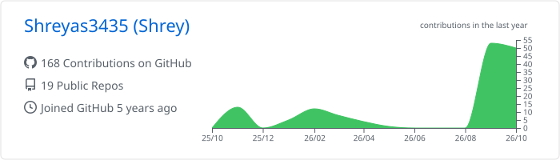
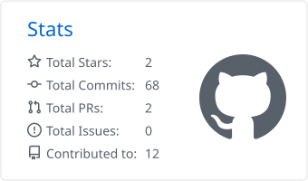
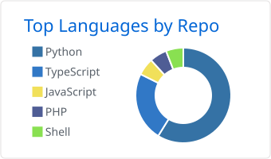

<!-- Hero (generated by scripts/gen_assets.py) -->
<p align="center">
  
</p>

<p align="center">
  <a href="https://www.linkedin.com/in/shreyas-alva-baa888227"></a>
  <a href="https://portfolio-six-bice-90.vercel.app"></a>
  <a href="https://github.com/Shreyas3435?tab=repositories"></a>
</p>

<p align="center">
  
</p>

<p align="center">
  
</p>


```ts
const shreyas = {
  role:       "Full Stack Developer",
  focus:      ["AI agents & MCP tooling", "secure web apps", "data pipelines"],
  previously: "Database Management Intern @ HCL Aftermarket Cloud",
  education:  "B.E. Computer Science, VTU",
  certified:  ["Tata Group — Cybersecurity", "Mastercard — Cybersecurity"],
  motto:      "Building. Learning. Improving. Repeat.",
};
```


<details open>
<summary><b>🔭 What I'm building right now</b></summary>
<br />

- 🤖 **Agent infrastructure** — compilers that turn OpenAPI specs into scored MCP tool surfaces, and gateways that serve knowledge bundles to agents with trust policies
- 🗺️ **Developer tooling** — architecture maps of Python & TypeScript repos, CI quality gates, schema-driven data importers
- 🏭 **Vertical marketplaces** — verified-manufacturer discovery platforms for D2C founders in India
- 🧠 **Personal automation** — a local "Jarvis" with a deterministic core and on-demand AI

</details>


<p align="center">
  <a href="https://skillicons.dev">
    
    <br />
    
    <br />
    
  </a>
</p>


<table>
  <tr>
    <td width="50%" valign="top">
      <h3>🏔️ <a href="https://github.com/Shreyas3435/trek-saathi">Trek Saathi</a></h3>
      <p>Discovery &amp; booking platform for treks in the Western Ghats — trekker, organizer and admin roles on one FastAPI + Postgres backend.</p>
      
      
      
      <br /><br />
      <a href="https://trek-saathi.vercel.app"></a>
    </td>
    <td width="50%" valign="top">
      <h3>💊 <a href="https://github.com/Shreyas3435/Blockchain_in_pharma">Blockchain in Pharma</a></h3>
      <p>Track-and-trace for medicines from manufacturer to customer, keeping quality and pricing transparent on-chain.</p>
      
      
      <br /><br />
      <a href="https://github.com/Shreyas3435/Blockchain_in_pharma"></a>
    </td>
  </tr>
  <tr>
    <td width="50%" valign="top">
      <h3>🎬 <a href="https://github.com/Shreyas3435/movie-data-pipeline">Movie Data Pipeline</a></h3>
      <p>ETL pipeline for movie analytics — pulls from the OMDb API, cleans, and loads into SQLite.</p>
      
      
      <br /><br />
      <a href="https://github.com/Shreyas3435/movie-data-pipeline"></a>
    </td>
    <td width="50%" valign="top">
      <h3>🌐 <a href="https://github.com/Shreyas3435/portfolio">Portfolio</a></h3>
      <p>My personal portfolio — projects, experience and contact in one place.</p>
      
      
      <br /><br />
      <a href="https://portfolio-six-bice-90.vercel.app"></a>
    </td>
  </tr>
</table>

<details>
<summary><b>🔐 Security toolkit</b> &nbsp;<sub>(5 repos — click to expand)</sub></summary>
<br />

| Project | What it does |
| --- | --- |
| [Network Packet Analyzer](https://github.com/Shreyas3435/Network-Packet-Analyzer) | Captures and inspects network packets for protocol-level analysis |
| [Pixel Manipulation Encryption](https://github.com/Shreyas3435/Pixel-Manipulation-for-Image-Encryption) | Encrypts and decrypts images by manipulating pixel values |
| [Password Complexity Checker](https://github.com/Shreyas3435/Password-Complexity-Checker) | Scores password strength against common complexity rules |
| [Caesar Cipher](https://github.com/Shreyas3435/Implement-Caesar-Cipher) | Classic shift cipher for encrypting and decrypting text |
| [Hashing](https://github.com/Shreyas3435/Hashing) | PHP sign-up / login flow with hashed password storage |

</details>

<details>
<summary><b>🧪 AI & data experiments</b> &nbsp;<sub>(click to expand)</sub></summary>
<br />

| Project | What it does |
| --- | --- |
| [Website Content Search](https://github.com/Shreyas3435/website-content-search) | Semantic search over website content — BeautifulSoup parsing, Weaviate vectors, Flask + React |
| [Ai_Summary](https://github.com/Shreyas3435/Ai_Summary) | Dockerised AI document-summary service with a web frontend |
| [Movie Data Pipeline](https://github.com/Shreyas3435/movie-data-pipeline) | ETL from the OMDb API into SQLite for analytics |
| [Artifact Editor (Frappe)](https://github.com/Shreyas3435/frappe-framework-Testing) | Template-driven, autosaving user-story editor built as a Frappe app |

</details>


<p align="center">
  <picture>
    <source media="(prefers-color-scheme: dark)" srcset="./profile-summary-card-output/github_dark/0-profile-details.svg" />
    
  </picture>
</p>

<p align="center">
  <picture>
    <source media="(prefers-color-scheme: dark)" srcset="./profile-summary-card-output/github_dark/3-stats.svg" />
    
  </picture>
  <picture>
    <source media="(prefers-color-scheme: dark)" srcset="./profile-summary-card-output/github_dark/1-repos-per-language.svg" />
    
  </picture>
</p>

<p align="center">
  <picture>
    <source media="(prefers-color-scheme: dark)" srcset="https://streak-stats.demolab.com?user=Shreyas3435&theme=github-dark-blue&hide_border=true&date_format=M%20j%5B%2C%20Y%5D" />
    
  </picture>
</p>


<!--START_SECTION:activity-->
- 🔨 Pushed to [**Site**](https://github.com/Shreyas3435/Site) · TypeScript · 9 days ago
- 🔨 Pushed to [**trek-saathi**](https://github.com/Shreyas3435/trek-saathi) · TypeScript · 45 days ago
- 🔨 Pushed to [**portfolio**](https://github.com/Shreyas3435/portfolio) · TypeScript · 47 days ago
- 🔨 Pushed to [**frappe-framework-Testing**](https://github.com/Shreyas3435/frappe-framework-Testing) · Python · 225 days ago
- 🔨 Pushed to [**form_builder**](https://github.com/Shreyas3435/form_builder) · Shell · 236 days ago
<!--END_SECTION:activity-->

<br />

<p align="center">
  <picture>
    <source media="(prefers-color-scheme: dark)" srcset="https://raw.githubusercontent.com/Shreyas3435/Shreyas3435/output/snake-dark.svg" />
    
  </picture>
</p>

<p align="center">
  
</p>
